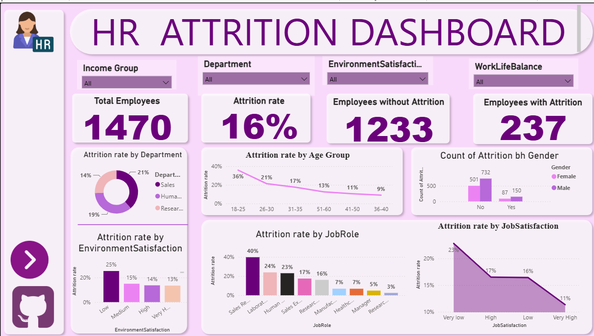
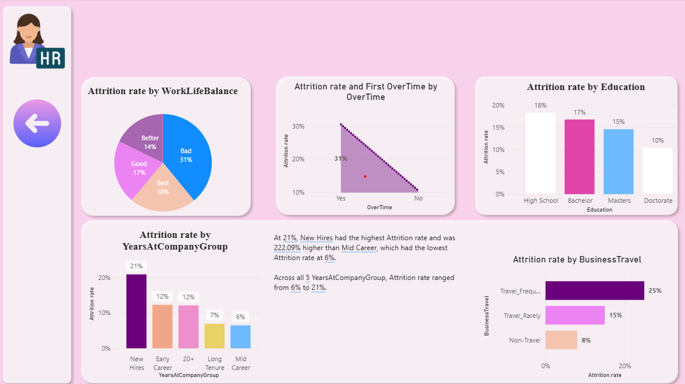

# HR Attrition Dashboard (Power BI)

An interactive Power BI dashboard analysing employee attrition across 1,470 employees, to show who leaves and which factors are linked to leaving.

## Dashboard preview

### Page 1: Overview

### Page 2: Drivers of attrition

## Business question
Why are employees leaving, and which groups are most at risk?

## Data
The data comes from the **IBM HR Analytics Employee Attrition & Performance** dataset on Kaggle. It is a public sample dataset, not real company data.
- 1,470 employees, of whom 237 left (16% attrition)
- Fields include department, job role, age, income, gender, education, overtime, business travel, satisfaction scores and years at the company

## Key findings
- **Overall attrition is 16%** (237 of 1,470 employees).
- **Overtime is the strongest signal:** 31% attrition for employees working overtime, against 10% for those who do not.
- **Business travel:** 25% attrition for frequent travellers, compared with 15% for rare travellers and 8% for non-travellers.
- **Early-career staff leave most:** 36% for ages 18-25, falling to 9% for ages 36-40. New hires have 21% attrition, against 6% for mid-career staff.
- **Role matters:** Sales Representatives have the highest attrition (40%), while Research Directors have the lowest (3%). By department, Sales is 21%, HR 19% and R&D 14%.
- **Satisfaction and work-life balance:** attrition is 25% where environment satisfaction is low (13% where very high), 31% where work-life balance is rated bad, and 23% at very low job satisfaction (11% at very high).
- **Education:** attrition falls as education level rises, from 18% (High School) to 10% (Doctorate).
- **Gender:** a small difference, about 15% for women and 17% for men.

## Suggested actions
These are hypotheses to investigate, not proven causes.
- Review overtime and workload, especially in high-attrition roles.
- Strengthen onboarding and support for first-year hires and younger employees.
- Look at pay, targets and progression for Sales Representatives.
- Review the travel demands placed on frequent travellers.
- Track satisfaction and work-life balance scores as early-warning indicators.

## Dashboard features
- KPI cards: total employees, attrition rate, employees who left and stayed
- Slicers: income group, department, environment satisfaction, work-life balance
- Two report pages with navigation buttons

## Tools and skills
- Power BI Desktop
- Data modelling and calculated measures
- Grouped fields (age group, income group, years-at-company group)
- Data visualisation and storytelling with data

## How to open
Download `HR ATTRITION DASHBOARD.pbix` and open it in Power BI Desktop (Windows).
